<div align="center">

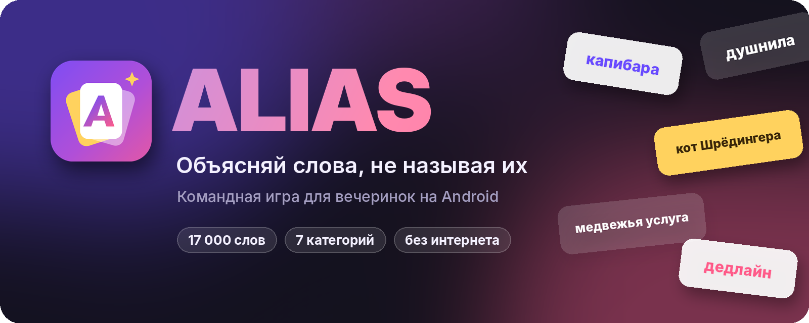

<br>
<br>

[](https://github.com/eezoy/alias-thegame/releases/latest)
[](https://github.com/eezoy/alias-thegame/actions)
<br>


<br>

### [⬇️ &nbsp;Скачать APK](https://github.com/eezoy/alias-thegame/releases/latest)

<sub>Бесплатно · без рекламы · работает без интернета</sub>

</div>

<br>

<p align="center">
  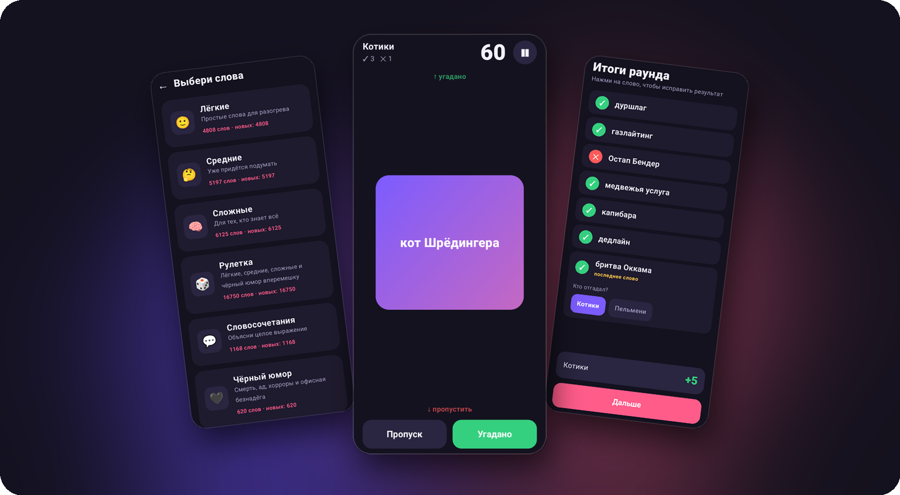
</p>

<br>

## 🎴 Об игре

**Alias** — командная игра для вечеринок. Один игрок объясняет слово своей команде, не называя его и однокоренные слова. Угадали — смахни карточку вверх, не получается — вниз. Кто за отведённое время объяснит больше, тот и побеждает.

Эта версия появилась, когда все слова в обычном Alias выучились наизусть. Здесь их почти **17 000**: от «дуршлага» до «бритвы Оккама», от «пранка» до «Камасутры».

<br>

## ✨ Возможности

<table>
  <tr>
    <td width="50%" valign="top">
      <h4>👆 Свайпы как в оригинале</h4>
      Вверх — угадано, вниз — пропуск. Карточка подсвечивается зелёным или красным прямо под пальцем. Для тех, кому неудобно смахивать, есть кнопки.
    </td>
    <td width="50%" valign="top">
      <h4>🤫 Кнопка «Старт»</h4>
      После «Поехали!» слово скрыто, таймер стоит. Объясняющий спокойно берёт телефон и сам запускает раунд.
    </td>
  </tr>
  <tr>
    <td valign="top">
      <h4>⏰ Последнее слово без лимита</h4>
      Время вышло, а слово ещё на экране? Его доигрывают сколько угодно. По желанию отгадать его может любая команда.
    </td>
    <td valign="top">
      <h4>✍️ Свои слова</h4>
      Добавляйте шутки своей компании прямо с телефона: «кот Борис», «Серёгина тачка». Играйте ими отдельно или подмешивайте в рулетку.
    </td>
  </tr>
  <tr>
    <td valign="top">
      <h4>🔁 Без повторов</h4>
      Игра запоминает выпавшие слова и не показывает их снова, пока не пройдёт весь словарь.
    </td>
    <td valign="top">
      <h4>✏️ Честный подсчёт</h4>
      После раунда видно все слова. Случайно смахнули не туда — нажмите на слово и исправьте.
    </td>
  </tr>
  <tr>
    <td valign="top">
      <h4>🎚 Гибкие настройки</h4>
      От 2 до 6 команд, раунд от 15 до 120 секунд, игра до 20–100 очков, штраф за пропуск.
    </td>
    <td valign="top">
      <h4>🔔 Пауза и звук</h4>
      Пауза скрывает слово. Последние пять секунд тикают, конец раунда слышно, а экран не гаснет.
    </td>
  </tr>
</table>

<br>

## 📚 Категории

| | Категория | Слов | Что внутри |
|:-:|---|--:|---|
| 🙂 | **Лёгкие** | 4 772 | Быт, еда, животные, природа, транспорт, дача. Для разогрева |
| 🤔 | **Средние** | 5 145 | Работа, учёба, деньги, гаджеты, кино, характеры, сленг |
| 🧠 | **Сложные** | 6 111 | Наука, философия, искусство, литература, мифы, редкие слова |
| 🎲 | **Рулетка** | 16 334 | Лёгкие, средние, сложные и чёрный юмор вперемешку |
| 💬 | **Словосочетания** | 663 | Идиомы, поговорки, крылатые выражения, отношения, 18+ |
| 🖤 | **Чёрный юмор** | 306 | Похороны, нечисть, хорроры, маньяки, апокалипсис |
| ✍️ | **Мои слова** | ∞ | Ваши собственные слова |

> [!NOTE]
> В словарях есть слова для взрослой компании (18+), а в «Чёрном юморе» — мрачные темы. Слов, которые унижают людей по национальности, здоровью или внешности, нет.

<br>

## 🎮 Как играть

1. **Соберите команды.** Минимум две, максимум шесть. Названия можно придумать свои.
2. **Выберите категорию и настройки.** Время раунда, сколько очков нужно до победы, нужен ли штраф за пропуск.
3. **Передайте телефон объясняющему.** Он нажимает «Поехали!», а затем «Старт», и время пошло.
4. **Объясняйте.** Нельзя называть само слово и однокоренные. Жесты, синонимы, ассоциации и «… да рыбку из пруда» — можно.
5. **Смахивайте.** ⬆️ угадали (+1), ⬇️ пропуск (−1, если включён штраф).
6. **Проверьте итоги** и передайте ход следующей команде.

🏆 Побеждает команда, которая первой наберёт нужное число очков. Победитель определяется, когда все команды сделали одинаковое число ходов, так что всё честно.

<br>

## 📱 Скриншоты

<table>
  <tr>
    <td align="center">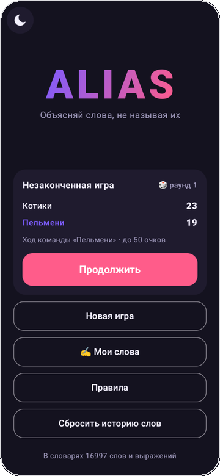<br><sub><b>Главное меню</b></sub></td>
    <td align="center">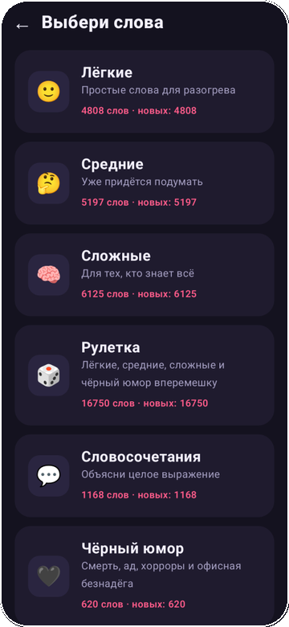<br><sub><b>Выбор категории</b></sub></td>
    <td align="center">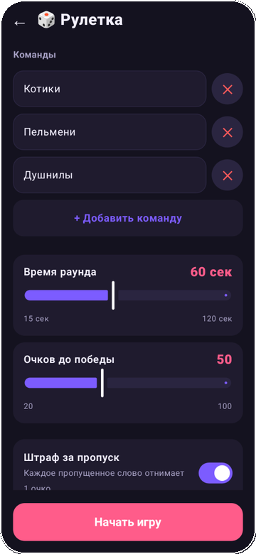<br><sub><b>Команды и настройки</b></sub></td>
  </tr>
  <tr>
    <td align="center">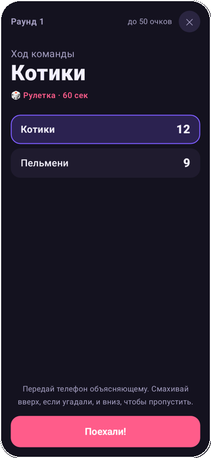<br><sub><b>Чей ход и счёт</b></sub></td>
    <td align="center">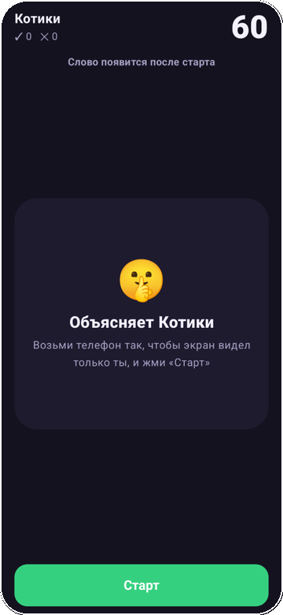<br><sub><b>Старт раунда</b></sub></td>
    <td align="center">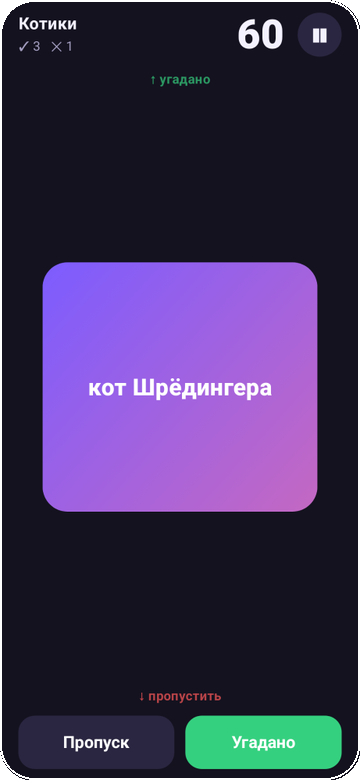<br><sub><b>Объясняем</b></sub></td>
  </tr>
  <tr>
    <td align="center">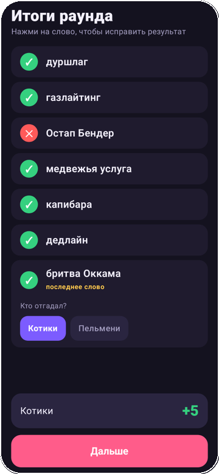<br><sub><b>Итоги раунда</b></sub></td>
    <td align="center">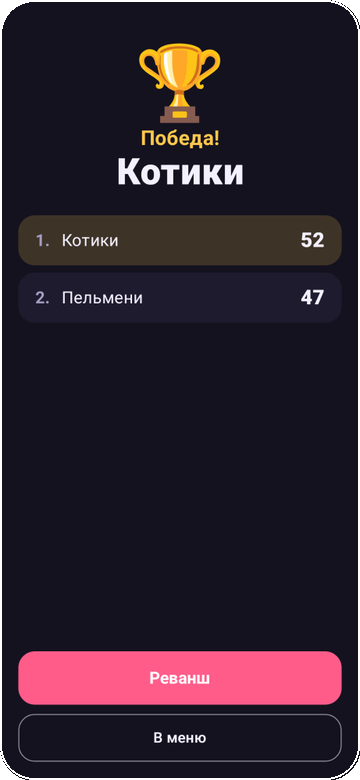<br><sub><b>Победа</b></sub></td>
    <td align="center">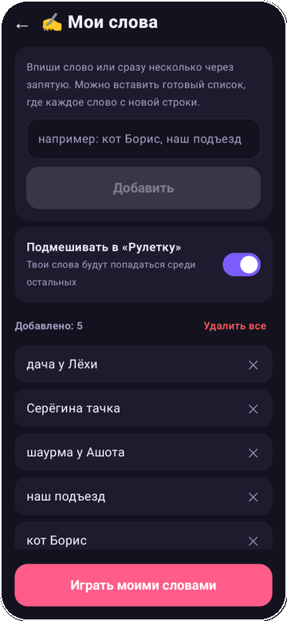<br><sub><b>Мои слова</b></sub></td>
  </tr>
</table>

<br>

## 📥 Установка

1. Откройте страницу **[последнего релиза](https://github.com/eezoy/alias-thegame/releases/latest)** с телефона.
2. Скачайте файл `Alias-1.0.N.apk`.
3. Откройте его. Если Android спросит, разрешите установку из этого источника.

> [!TIP]
> Новые версии ставятся поверх старых. Ваши слова, настройки и история выпавших слов сохраняются. Если иконка на рабочем столе не обновилась, перезагрузите телефон.

<br>

## ✍️ Добавить свои слова

**В приложении.** Главное меню → **«Мои слова»**. Можно вписать слово, несколько через запятую или вставить целый список. Если слово уже есть во встроенных словарях, приложение подскажет, в какой категории. Слова хранятся только на этом телефоне.

**Для всех игроков сразу.** Добавьте слова во встроенные словари в папке [`app/src/main/assets/words/`](app/src/main/assets/words):

| Файл | Категория |
|---|---|
| [`easy.txt`](app/src/main/assets/words/easy.txt) | 🙂 Лёгкие |
| [`medium.txt`](app/src/main/assets/words/medium.txt) | 🤔 Средние |
| [`hard.txt`](app/src/main/assets/words/hard.txt) | 🧠 Сложные |
| [`phrases.txt`](app/src/main/assets/words/phrases.txt) | 💬 Словосочетания |
| [`dark.txt`](app/src/main/assets/words/dark.txt) | 🖤 Чёрный юмор |

Одна строка — одно слово или выражение, строки с `#` считаются комментариями. Отредактировать файл можно прямо на сайте GitHub: значок ✏️ → **Commit changes**. Через 3–5 минут в [Releases](https://github.com/eezoy/alias-thegame/releases) появится новая версия.

<br>

## 🛠 Под капотом

<table>
  <tr>
    <td><b>Язык</b></td><td>Kotlin</td>
  </tr>
  <tr>
    <td><b>Интерфейс</b></td><td>Jetpack Compose, Material 3</td>
  </tr>
  <tr>
    <td><b>Android</b></td><td>8.0 и новее (minSdk 26, targetSdk 35)</td>
  </tr>
  <tr>
    <td><b>Сборка</b></td><td>Gradle + GitHub Actions: каждый коммит в <code>main</code> собирает подписанный APK и публикует релиз</td>
  </tr>
  <tr>
    <td><b>Данные</b></td><td>Словари — текстовые файлы в <code>assets</code>, свои слова и история — <code>SharedPreferences</code></td>
  </tr>
</table>

<details>
<summary><b>Структура проекта</b></summary>

```
alias-thegame/
├── app/src/main/
│   ├── assets/words/          # словари: easy, medium, hard, phrases, dark
│   ├── java/com/eezoy/alias/
│   │   ├── MainActivity.kt
│   │   ├── GameViewModel.kt   # логика игры, таймер, очки
│   │   ├── Words.kt           # категории, словари, свои слова, колода
│   │   └── ui/                # экраны на Compose
│   └── res/                   # иконка, тема
├── docs/                      # картинки для README
└── .github/workflows/build.yml
```

</details>

<details>
<summary><b>Собрать самому</b></summary>

```bash
git clone https://github.com/eezoy/alias-thegame.git
cd alias-thegame
./gradlew assembleRelease
# APK: app/build/outputs/apk/release/app-release.apk
```

Нужны JDK 17+ и Android SDK (проще всего открыть проект в Android Studio).

</details>

<br>

## 💜 Благодарности

Часть общей лексики отобрана из открытых словарей [**Roman-/dicts**](https://github.com/Roman-/dicts) (подборки Orange Alias, «Шляпа» и rus_custom). Сложность определена по частотному словарю, а тематические слова, словосочетания и чёрный юмор написаны вручную.

<br>

<div align="center">
  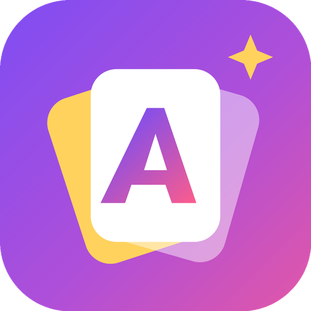
  <br>
  <sub>Сделано для своей компании, чтобы слова снова было сложно угадать 🎉</sub>
</div>
